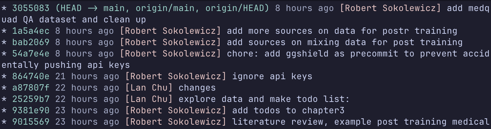

+++
title = "My git setup: fish abbreviations, delta and mergiraf"
date = "2026-09-27"
author = "Robert"
cover = ""
description = "A quick guide of everything I've added to git: fish abbreviations via fisher and plugin-git, a few custom ones, delta as a pager, mergiraf as a merge driver, and the handful of config defaults."
draft = false
+++

I type `git` more than anything else in my terminal, so over time I've
configured and added a few things which may be worth sharing.

# Fish abbreviations with plugin-git

I use [fish](https://fishshell.com/) shell with
[fisher](https://github.com/jorgebucaran/fisher) as the plugin manager. The only
git-related plugin is
[jhillyerd/plugin-git](https://github.com/jhillyerd/plugin-git), which ports the
oh-my-zsh git aliases to fish:

```shell
fisher install jhillyerd/plugin-git
```

It adds about 180 abbreviations. Unlike aliases, abbreviations expand in place
when you hit space, so you still see (and can edit) the full command before
running it, and your history contains the real command. A few of them:

| abbr    | expands to                           |
| ------- | ------------------------------------ |
| `gst`   | `git status`                         |
| `gss`   | `git status -s`                      |
| `gcm`   | `git commit -m`                      |
| `gcb`   | `git checkout -b`                    |
| `gd`    | `git diff`                           |
| `gp`    | `git push`                           |
| `gpra`  | `git pull --rebase --autostash`      |
| `gcan!` | `git commit -v -a --no-edit --amend` |

It also ships some functions: `gwip`/`gunwip` to park your work in a throwaway
WIP commit and undo it later, `gbda` to delete all merged branches, and `grt` to
`cd` to the repo root.

## My own abbreviations

On top of that I have three of my own in `~/.config/fish/config.fish`:

```shell
# pretty one-line graph log
abbr -a glog 'git log --graph --decorate --color --format="%C(auto)%C(#8bd5ca)%h%d %C(#a5adcb)%cr %C(#f0c6c6)[%aN]%C(reset) %C(#cad3f5)%s"'

# pull the latest version of the branch I'm on
abbr -a gsync 'git fetch origin; and git pull --rebase --autostash origin (git branch --show-current)'

# rebase my branch onto the latest main
abbr -a grom 'git fetch origin; and git rebase origin/main'
```

`glog` overrides the one from the git plugin, but made it more pretty:



`grom` is handy right before opening a merge request, so the branch sits on top
of a fresh `main`. It's also good to this on the main branch.

and `gsync` is handy when you apply suggestions on github/github and need to
rebase locally.

# delta as the pager

[delta](https://github.com/dandavison/delta) replaces the default diff output
with syntax highlighting and line numbers. It's used for `git diff`, `git show`,
`git log -p` and also the interactive `git add -p`:

```ini
[core]
    pager = delta
[interactive]
    diffFilter = delta --color-only
[delta]
    pager = less --mouse -RF
    navigate = true
    dark = true
    line-numbers = true
    syntax-theme = Dracula
```

`navigate = true` lets you jump between files in a diff with `n` and `N`, and
`--mouse` makes scrolling work in the pager.

# mergiraf for merge conflicts

[mergiraf](https://mergiraf.org/) is a syntax-aware merge driver. Instead of
comparing lines, it parses the file and merges the syntax trees, so two people
adding different functions at the end of the same file, or different imports, no
longer produces a conflict. Setup is two parts. First, register it as a merge
driver in `~/.gitconfig`:

```ini
[merge "mergiraf"]
    name = mergiraf
    driver = mergiraf merge --git %O %A %B -s %S -x %X -y %Y -p %P -l %L
```

Then tell git to use it for every file in `~/.config/git/attributes`:

```
* merge=mergiraf
```

For languages it doesn't understand it falls back to the normal line-based
merge, so there's no downside to enabling it globally.

# Config defaults

The rest of `~/.gitconfig` is a few defaults that remove friction:

```ini
[pull]
    rebase = true        # never create merge commits on pull
[rebase]
    autoStash = true     # stash uncommitted changes before a rebase, pop them after
[push]
    default = current    # push to a branch with the same name, no --set-upstream needed
[diff]
    tool = code
[difftool "code"]
    cmd = code --wait --diff \"$LOCAL\" \"$REMOTE\"
[alias]
```

# Everything else

- [gh](https://cli.github.com/) and [glab](https://gitlab.com/gitlab-org/cli)
  for GitHub and GitLab from the terminal.
- `ll` is aliased to `eza -la --git --git-repos ...`, which shows the git status
  of every file in a directory listing.
